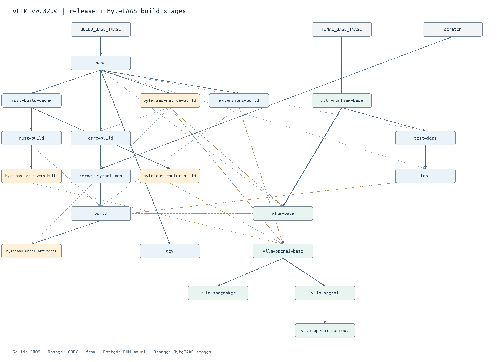

# Dockerfile

We provide a [docker/Dockerfile](../../../docker/Dockerfile) to construct the image for running an OpenAI compatible server with vLLM.
More information about deploying with Docker can be found [here](../../deployment/docker.md).

Below is a visual representation of the multi-stage Dockerfile. The build graph contains the following nodes:

- All build stages
- The default build target (highlighted in grey)
- External images (with dashed borders)

The edges of the build graph represent:

- `FROM ...` dependencies (with a solid line and a full arrow head)

- `COPY --from=...` dependencies (with a dashed line and an empty arrow head)

- `RUN --mount=(.\*)from=...` dependencies (with a dotted line and an empty diamond arrow head)

The `test-deps` stage branches from `vllm-runtime-base` so Git and the test
requirements remain cached independently of per-commit vLLM wheels and source.

The `extensions-build` stage can also produce an optional source-built Triton
wheel. `vllm-openai-base` installs that wheel after its other Python
dependencies so dependency resolution cannot restore an older Triton version.

With `BUILD_NIXL=true`, `extensions-build` also builds NIXL, including its NIXL
EP extension for the installed PyTorch, with `tools/build_nixl_with_torch215_for_rubin.py`.
`vllm-openai-base` then replaces the NIXL packages installed from the KV-connector
requirements with these wheels.

ByteIAAS builds use contract 2 on v0.32.0, Torch 2.13.0, CUDA 13.0.3,
Python 3.12, and Ubuntu 24.04. The public build leaves the three flags below
disabled. Internal dev/release workflows enable all three:

```bash
docker build --target vllm-openai -f docker/Dockerfile \
  --build-arg BYTEIAAS_BUILD_NATIVE=true \
  --build-arg BYTEIAAS_BUILD_TOKENIZERS=true \
  --build-arg BYTEIAAS_BUILD_ROUTER=true .
```

`byteiaas-native-build` reconstructs DeepGEMM and Humming from their immutable
upstream bases and checked-in patches under `docker/byteiaas/native`. The
DeepGEMM source feeds both the native wheel and vLLM csrc builds. Humming uses
one wheel for Prefill and Decode; its version also enters the vLLM wheel's
dependency metadata. Do not set a role-specific Humming `PYTHONPATH`.

`byteiaas-tokenizers-build` builds commit `441393c7` with the release Rust
toolchain and manylinux_2_28. `byteiaas-router-build` builds commit `ef339bc7`,
checks Cargo.lock, and repairs its wheel to manylinux_2_28.
`vllm-openai-base` verifies wheel checksums, reinstalls these packages after
dependency resolution, and records installed file and capability checks in
`/opt/byteiaas/provenance`. `/opt/byteiaas/image-metadata.json` contains the
effective dependency source trees, wheel hashes, and build source identity.
Native source commit IDs describe the local port; builds reconstruct their
trees and do not require those IDs to be published to an upstream repository.

`byteiaas-wheel-artifacts` exports the vLLM wheel and the two native wheels
with manifests for the wheel CI job. The image CI retains OCI, zstd, and Nydus
publication with digest and format verification. Run
`tools/byteiaas/validate_build_contract.py` before an internal build to reject
stale source locks or release defaults.

  > <figure markdown="span">
  >   { align="center" alt="query" width="100%" }
  > </figure>
  >
  > Made using: <https://github.com/patrickhoefler/dockerfilegraph>
  >
  > Commands to regenerate the build graph (make sure to run it **from the \`root\` directory of the vLLM repository** where the dockerfile is present):
  >
  > ```bash
  > dockerfilegraph \
  >   -o png \
  >   --concentrate \
  >   --legend \
  >   --dpi 200 \
  >   --max-label-length 50 \
  >   --filename docker/Dockerfile
  > ```
  >
  > or in case you want to run it directly with the docker image:
  >
  > ```bash
  > docker run \
  >    --rm \
  >    --user "$(id -u):$(id -g)" \
  >    --workdir /workspace \
  >    --volume "$(pwd)":/workspace \
  >    ghcr.io/patrickhoefler/dockerfilegraph:alpine \
  >    --output png \
  >    --dpi 200 \
  >    --max-label-length 50 \
  >    --filename docker/Dockerfile \
  >    --concentrate \
  >    --legend
  > ```
  >
  > (To run it for a different file, you can pass in a different argument to the flag `--filename`.)
